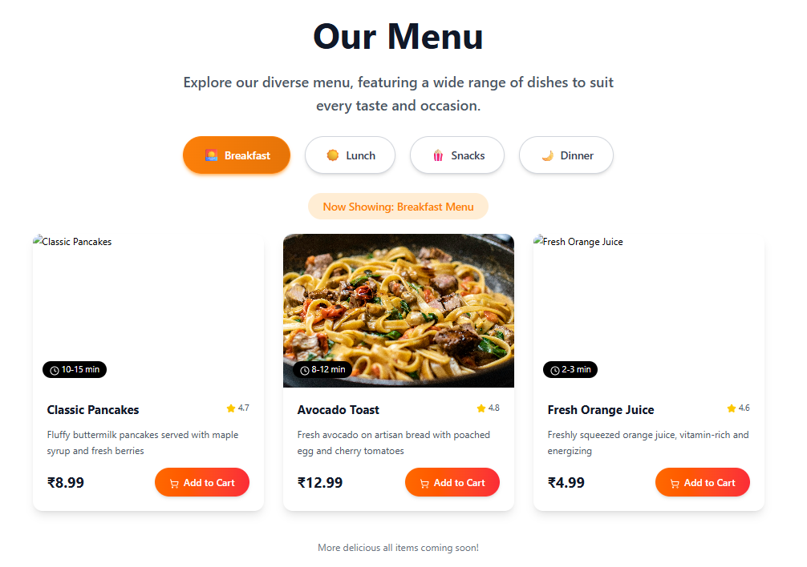
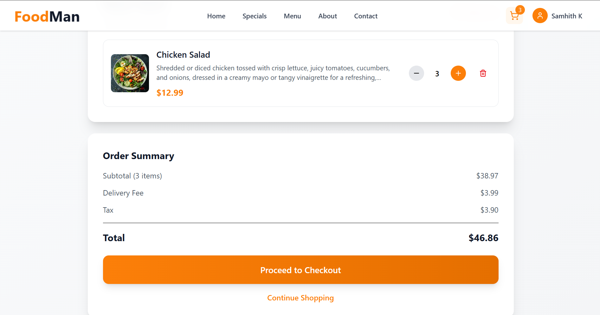
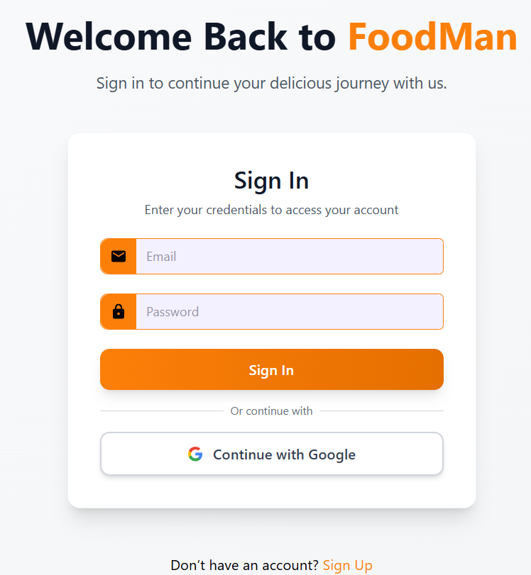

# FoodMan - Food Delivery App

A comprehensive, modern food delivery application built with React, Vite, Firebase, and Tailwind CSS. Experience seamless ordering with a beautiful, responsive interface and robust cart functionality.

## 🛠️ Tech Stack

**Frontend:**

- React 18 + Vite
- Tailwind CSS
- React Router DOM
- Lucide React Icons

**Backend & Services:**

- Firebase Authentication
- Firestore Database
- Firebase Storage

**Development:**

- ESLint + Prettier
- Hot Module Replacement
- Environment Variables

## 📸 Screenshots

### Home Page


_Beautiful hero section with featured specials and intuitive navigation_

### Menu System


_Dynamic menu with category filtering and meal time selection_

### Shopping Cart


_Comprehensive cart management with order summary and calculations_

### Authentication


_Seamless sign-up and login with Google integration_
_Fully responsive design optimized for all devices_

### Live Demo

🔗 [View Live Demo](https://your-demo-url.com)

## ✨ Features

### 🔐 Authentication & Security

- **Dual Authentication**: Email/Password and Google Sign-in
- **Protected Routes**: Secure access to authenticated areas
- **Environment Variables**: Secure Firebase configuration
- **Route Guards**: Automatic redirects for unauthorized access
- **Persistent Sessions**: Stay logged in across browser sessions

### 🛒 Shopping Cart System

- **Real-time Cart Management**: Add, remove, and update quantities
- **Persistent Storage**: Cart persists across browser sessions
- **Dynamic Cart Badge**: Live item count in navigation
- **Order Summary**: Automatic calculation of subtotal, tax, and delivery
- **Visual Feedback**: Success indicators and quantity displays

### 🍽️ Menu & Specials

- **Dynamic Menu System**: Browse by meal times (Breakfast, Lunch, Dinner, Snacks)
- **Category Filtering**: Filter by Appetizers, Main Courses, Desserts, Drinks
- **Special Dishes Carousel**: Featured items with ratings and cook times
- **Dedicated Specials Page**: Extended catalog with premium offerings
- **Smart Navigation**: Menu button scrolls to menu section

### 📱 Responsive Design

- **Mobile-First**: Optimized for all screen sizes (320px to 4K+)
- **Touch-Friendly**: Large buttons and intuitive gestures
- **Adaptive Layouts**: Grid systems that adjust to screen size
- **Professional UI**: Modern design with smooth animations
- **Accessibility**: Keyboard navigation and screen reader support

### 🎨 User Experience

- **Smooth Animations**: Hover effects and transitions
- **Loading States**: Professional spinners and feedback
- **Error Handling**: User-friendly error messages
- **Visual Hierarchy**: Clear typography and spacing
- **Interactive Elements**: Engaging micro-interactions

## 🚀 Quick Start

### Prerequisites

- **Node.js** (v16 or higher)
- **npm** or **yarn**
- **Firebase Account** (free tier available)

### Installation

1. **Clone the repository**

   ```bash
   git clone <repository-url>
   cd foodman-app
   ```

2. **Install dependencies**

   ```bash
   npm install
   ```

3. **Set up environment variables**

   ```bash
   # Copy the example file
   cp .env.example .env

   # Edit .env with your Firebase configuration
   VITE_FIREBASE_API_KEY=your_api_key_here
   VITE_FIREBASE_AUTH_DOMAIN=your_auth_domain_here
   VITE_FIREBASE_PROJECT_ID=your_project_id_here
   VITE_FIREBASE_STORAGE_BUCKET=your_storage_bucket_here
   VITE_FIREBASE_MESSAGING_SENDER_ID=your_messaging_sender_id_here
   VITE_FIREBASE_APP_ID=your_app_id_here
   ```

4. **Start the development server**

   ```bash
   npm run dev
   ```

5. **Open your browser**
   ```
   http://localhost:5173
   ```

## 🔥 Firebase Setup

### 1. Create Firebase Project

1. Go to [Firebase Console](https://console.firebase.google.com/)
2. Click "Create a project"
3. Follow the setup wizard

### 2. Enable Authentication

1. Navigate to **Authentication** → **Sign-in method**
2. Enable **Email/Password** provider
3. Enable **Google** provider
4. Configure OAuth consent screen

### 3. Create Firestore Database

1. Navigate to **Firestore Database**
2. Click "Create database"
3. Choose **Start in test mode** (for development)
4. Select your preferred location

### 4. Get Configuration

1. Go to **Project Settings** → **General**
2. Scroll to "Your apps" section
3. Click **Web app** icon
4. Copy the configuration object
5. Add values to your `.env` file

## 📜 Available Scripts

| Command           | Description                              |
| ----------------- | ---------------------------------------- |
| `npm run dev`     | Start development server with hot reload |
| `npm run build`   | Build optimized production bundle        |
| `npm run preview` | Preview production build locally         |
| `npm run lint`    | Run ESLint for code quality              |

## 📁 Project Structure

```
src/
├── components/          # Reusable UI components
│   ├── Header.jsx      # Navigation with cart integration
│   ├── LoadingSpinner.jsx # Loading states
│   ├── ProtectedRoute.jsx # Route protection
│   └── PublicRoute.jsx # Public route handling
├── contexts/           # React Context providers
│   ├── AuthContext.jsx # Authentication state
│   └── CartContext.jsx # Shopping cart state
├── pages/              # Main application pages
│   ├── Auth/           # Sign-up page
│   ├── LoginIn/        # Sign-in page
│   ├── MainPage/       # Home with menu
│   ├── Cart/           # Shopping cart
│   └── Specials/       # Special dishes catalog
├── config/             # Configuration files
│   └── firebase-config.js # Firebase setup
├── utils/              # Utility functions
│   └── responsive.js   # Responsive design helpers
└── assets/             # Static assets (images, icons)
```

## 🛡️ Security Features

- **Environment Variables**: Sensitive data protected
- **Route Protection**: Authentication-based access control
- **Firebase Security Rules**: Database access control
- **Input Validation**: Form data sanitization
- **HTTPS Enforcement**: Secure data transmission
- **Session Management**: Secure user sessions

## 🎯 Key Pages & Features

### Authentication Flow

- **Sign Up** (`/`) - Create new account with email or Google
- **Sign In** (`/login`) - Login with existing credentials
- **Auto-redirect** - Seamless navigation after authentication

### Main Application

- **Home** (`/main`) - Hero section, specials carousel, menu navigation
- **Specials** (`/specials`) - Extended catalog of premium dishes
- **Cart** (`/cart`) - Full cart management with order summary
- **Menu Navigation** - Smart scrolling to menu sections

## 🛒 Cart System Details

### Features

- **Add to Cart**: One-click adding from any menu item
- **Quantity Management**: Increase/decrease with visual feedback
- **Real-time Updates**: Live cart count in navigation
- **Persistent Storage**: Cart survives browser refresh
- **Order Calculations**: Automatic subtotal, tax (8%), delivery ($3.99)

### User Experience

- **Visual Feedback**: Success checkmarks and quantity indicators
- **Empty State**: Helpful guidance when cart is empty
- **Responsive Design**: Optimized for mobile and desktop
- **Quick Actions**: Easy item removal and quantity updates

## 🎨 Design System

### Colors

- **Primary**: `#fc7f09` (Orange)
- **Secondary**: `#2E2B41` (Dark Blue)
- **Success**: `#10B981` (Green)
- **Error**: `#EF4444` (Red)

### Typography

- **Headings**: Bold, responsive scaling
- **Body**: Clean, readable fonts
- **Interactive**: Clear button labels

### Components

- **Buttons**: Gradient backgrounds with hover effects
- **Cards**: Elevated design with smooth shadows
- **Forms**: Clean inputs with validation feedback
- **Navigation**: Smooth transitions and active states

## 🚀 Deployment

### Build for Production

```bash
npm run build
```

### Deploy to Firebase Hosting

```bash
npm install -g firebase-tools
firebase login
firebase init hosting
firebase deploy
```

### Deploy to Vercel

```bash
npm install -g vercel
vercel
```

## 🤝 Contributing

1. Fork the repository
2. Create a feature branch (`git checkout -b feature/amazing-feature`)
3. Commit your changes (`git commit -m 'Add amazing feature'`)
4. Push to the branch (`git push origin feature/amazing-feature`)
5. Open a Pull Request

## 📄 License

This project is licensed under the MIT License - see the [LICENSE](LICENSE) file for details.

## 🙏 Acknowledgments

- **React Team** - For the amazing framework
- **Firebase** - For backend services
- **Tailwind CSS** - For the utility-first CSS framework
- **Lucide React** - For beautiful icons
- **Vite** - For lightning-fast development
